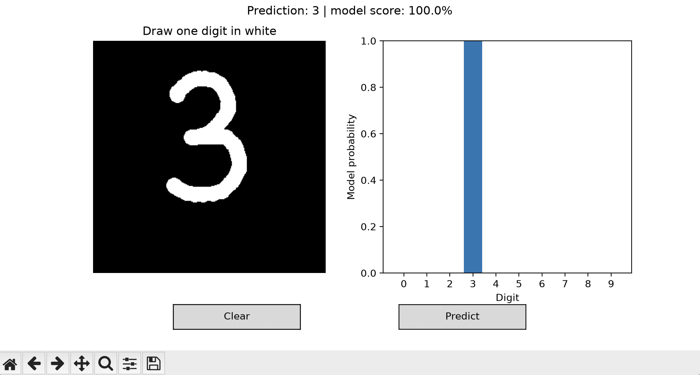

# MNIST Digit Classifier

A handwritten-digit recognition project built with Python and PyTorch. It trains a convolutional neural network to recognize digits from 0–9 and includes a desktop interface for drawing a digit and viewing the model’s predictions.

The model achieved **99.12% accuracy on 10,000 held-out MNIST test images** after five training epochs.

## Demo



Draw a digit and view the model’s predicted probabilities across all ten classes.

## Results

| Metric | Result |
| --- | --- |
| Test accuracy | **99.12%** |
| Macro F1 | **0.9911** |
| Best validation accuracy | **98.90%** |
| Training / validation images | 55,000 / 5,000 |
| Test images | 10,000 |
| Training epochs | 5 |
| Training device | Apple MPS |

The checkpoint was selected using validation accuracy, then evaluated separately on the official MNIST test set. These results measure performance on MNIST images; accuracy on drawings made in the interface has not been measured separately.

## About the project

I used this project to practice the full workflow of an image classification system: preparing data, training a model, evaluating its mistakes, saving a checkpoint, and using it for interactive predictions.

The CNN follows the established PyTorch MNIST example. The project combines that foundation with a modular training and evaluation workflow, image preprocessing, visual reports, and a drawing interface. Tutorial sources and AI-assisted reconstruction are acknowledged in [SOURCES.md](SOURCES.md).

## Features

- **Model training:** CNN with convolutional layers, max pooling, dropout, and fully connected layers.
- **Validation-based checkpoint selection:** saves the model with the highest validation accuracy.
- **Error analysis:** per-digit precision, recall, F1 scores, confusion matrix, and examples of misclassified images.
- **Training visualization:** plots training and validation loss and accuracy.
- **Interactive predictions:** draw a digit in a Matplotlib window and view probabilities for all ten classes.
- **Image prediction:** classify an isolated digit from a PNG or JPG.
- **Device support:** automatic selection of CPU, NVIDIA CUDA, or Apple MPS.

## Getting started

Use a Python environment with compatible PyTorch and torchvision installations. The project passed functional tests under Python 3.12; the local macOS training run used Python 3.14.

From the project folder, create a virtual environment:

```bash
python3 -m venv .venv
```

Activate it on macOS or Linux:

```bash
source .venv/bin/activate
```

On Windows PowerShell:

```powershell
.venv\Scripts\Activate.ps1
```

Install dependencies:

```bash
python -m pip install --upgrade pip
python -m pip install -r requirements.txt
```

For a CUDA-specific installation, use the instructions on the [PyTorch website](https://pytorch.org/get-started/locally/).

The first training run downloads MNIST. A trained checkpoint is not included in the repository.

## Train and evaluate

```bash
python train.py --epochs 5
python evaluate.py
```

Training saves the best checkpoint to `outputs/best.pt`. Evaluation saves metrics and visual reports to `outputs/`.

| Output | Contents |
| --- | --- |
| `best.pt` | Selected model checkpoint and training configuration |
| `history.json` | Training and validation metrics by epoch |
| `test_metrics.json` | Test metrics and confusion matrix |
| `learning_curves.png` | Training and validation curves |
| `confusion_matrix.png` | Predictions compared with true labels |
| `misclassified.png` | Up to 25 test errors in dataset order |

To change the training configuration:

```bash
python train.py --epochs 8 --batch-size 128 --seed 42 --output-dir outputs/experiment
```

Use a different output directory for each experiment to preserve earlier results. Training starts a new run; resuming training from a checkpoint is not implemented.

## Draw a digit

After training, launch the desktop interface:

```bash
python app.py
```

Draw one digit, click **Predict**, and inspect the probability chart. Click **Clear** to try another digit.

The interface needs a local graphical environment. If PyCharm’s plot window does not support interaction, run the command in an external terminal.

## Predict an image

For a bright digit on a black background:

```bash
python predict.py digit.png --save-processed processed.png
```

For dark ink on a white background:

```bash
python predict.py digit.png --invert --save-processed processed.png
```

Preprocessing crops the foreground, resizes the digit to fit within a 20×20 area, centers it in a 28×28 image, and applies the training normalization.

Use one isolated digit on a plain background. The optional processed image helps diagnose input problems.

## Model architecture

| Layer | Output shape, excluding batch dimension |
| --- | --- |
| Grayscale input | 1 × 28 × 28 |
| 3×3 convolution + ReLU | 32 × 26 × 26 |
| 3×3 convolution + ReLU | 64 × 24 × 24 |
| 2×2 max pooling + dropout | 64 × 12 × 12 |
| Flatten | 9,216 |
| Fully connected + ReLU + dropout | 128 |
| Fully connected + log-softmax | 10 |

Training uses negative log-likelihood loss, the Adadelta optimizer, and a StepLR learning-rate scheduler.

## Project structure

| File | Purpose |
| --- | --- |
| `model.py` | CNN architecture |
| `data.py` | Dataset loading, splitting, and normalization |
| `engine.py` | Training and evaluation functions |
| `train.py` | Training command and checkpoint selection |
| `evaluate.py` | Test-set evaluation |
| `plots.py` | Learning curves and error visualizations |
| `preprocess.py` | Input preparation for handwritten digits |
| `predict.py` | Image prediction command |
| `app.py` | Desktop drawing interface |
| `utils.py` | Device selection, seeds, checkpoints, and JSON output |

## Testing and reproducibility

Install the development dependencies and run the tests:

```bash
python -m pip install -r requirements-dev.txt
python -m pytest -q
```

Five functional tests passed in the CPU build environment. They cover checkpoint loading, probability normalization, preprocessing, blank inputs, parameter updates, metric accounting, and drawing-interface callbacks.

Training uses seeded data splitting and random number generators. Exact results can still vary across hardware and dependency versions. To record an environment:

```bash
python -m pip freeze > environment-lock.txt
```

See [VALIDATION.md](VALIDATION.md) for the validation record.

## Limitations

MNIST images are small, centered, and standardized. Mouse drawings and photographs can differ substantially in stroke thickness, position, and background.

The model classifies nonblank inputs into one of ten digit classes. It does not detect whether an image is actually a digit, recognize multiple digits, or interpret its probability scores as calibrated certainty.

Potential next steps include comparing against a simpler baseline, testing data augmentation, and measuring performance on a separate collection of handwritten inputs.

## Acknowledgments

This project builds on the [official PyTorch MNIST example](https://github.com/pytorch/examples/tree/main/mnist) and uses the MNIST dataset by Yann LeCun, Corinna Cortes, and Christopher J. C. Burges.

See [SOURCES.md](SOURCES.md) for attribution and development context.
